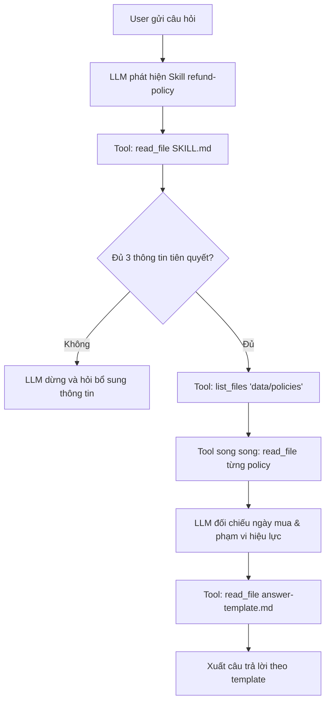

## 1. Kết quả Kiểm tra Tool 

Dưới đây là kết quả thực thi trực tiếp hàm `_list` / `list_files` trên các trường hợp kiểm thử biên:

| STT | Đầu vào `path` | Loại kiểm thử | Kết quả thực tế (JSON) | Đánh giá |
|:---:|:---|:---|:---|:---:|
| **1** | `data/policies` | Thư mục hợp lệ | `{"ok": true, "path": "data/policies", "items": [{"name": "policy-before-10.md", "path": "data/policies/policy-before-10.md", "type": "file"}, {"name": "policy-from-10.md", "path": "data/policies/policy-from-10.md", "type": "file"}]}` | **ĐẠT** |
| **2** | `data/weekly_notes.md` | Đường dẫn là file | `{"ok": false, "error": {"code": "NOT_A_DIRECTORY", "message": "Đây là file, không phải thư mục: data/weekly_notes.md"}}` | **ĐẠT** |
| **3** | `data/non_existent_folder` | Không tồn tại | `{"ok": false, "error": {"code": "DIR_NOT_FOUND", "message": "Không tìm thấy thư mục: data/non_existent_folder"}}` | **ĐẠT** |
| **4** | `../secret.txt` | Vượt workspace (`..`) | `{"ok": false, "error": {"code": "PATH_OUTSIDE_WORKSPACE", "message": "Đường dẫn thoát ra ngoài workspace: ../secret.txt"}}` | **ĐẠT** |
| **5** | `C:/Windows` | Đường dẫn tuyệt đối | `{"ok": false, "error": {"code": "PATH_OUTSIDE_WORKSPACE", "message": "Không chấp nhận đường dẫn tuyệt đối: C:/Windows. Dùng đường dẫn tương đối workspace."}}` | **ĐẠT** |

## 2. Kết quả Thực nghiệm và Phân tích Bằng chứng Trace

Toàn bộ quá trình thực thi đã được ghi nhận chi tiết qua 5 file trace tương ứng trong thư mục `Trace/` và các ảnh chụp màn hình trong `KetQua/`.



### 2.1. Trường hợp A: Mua trước ngày đổi chính sách
* **Câu hỏi:** *"Tôi mua ngày 28/09/2026, yêu cầu hoàn ngày 06/10/2026, chưa kích hoạt. Tôi có được hoàn không?"*
* **Tài liệu trong thư mục:** `policy-before-oct.md`, `policy-from-oct.md`.
* **Kết quả đối soát:**
  - Ngày mua: 28/09/2026 (< 01/10/2026) $\rightarrow$ Áp dụng chính sách `data/policies/policy-before-oct.md`.
  - Số ngày đã qua: $06/10/2026 - 28/09/2026 = 8\text{ ngày}$.
  - Giới hạn chính sách: Trong vòng 7 ngày.
  - Kết luận: **KHÔNG ĐỦ ĐIỀU KIỆN** (vượt quá 1 ngày). Phí: Không áp dụng.
* **Vị trí bằng chứng trong `Trace/TH-A-trace.json`:**
  - `messages[1]`: Assistant gọi tool `read_file({"path": "skills/refund-policy/SKILL.md"})`.
  - `messages[3]`: Assistant gọi tool `list_files({"path": "data/policies"})`.
  - `messages[4]`: Tool trả về danh sách có `policy-before-oct.md` và `policy-from-oct.md`.
  - `messages[5]`: Assistant gọi song song 2 tools đọc cả 2 file chính sách (`read_file`).
  - `messages[8]`: Assistant gọi tool `read_file({"path": "skills/refund-policy/references/answer-template.md"})`.
  - `messages[10]`: Phản hồi hoàn chỉnh, dẫn đúng căn cứ `data/policies/policy-before-oct.md`.
* **Ảnh minh chứng:** [KetQua/TH-A-ket-qua.png](KetQua/TH-A-ket-qua.png).

---

### 2.2. Trường hợp B: Mua từ ngày đổi chính sách
* **Câu hỏi:** *"Tôi mua ngày 02/10/2026, yêu cầu hoàn ngày 12/10/2026, chưa kích hoạt. Tôi có được hoàn không?"*
* **Tài liệu trong thư mục:** `policy-before-oct.md`, `policy-from-oct.md`.
* **Kết quả đối soát:**
  - Ngày mua: 02/10/2026 ($\ge$ 01/10/2026) $\rightarrow$ Áp dụng chính sách `data/policies/policy-from-oct.md`.
  - Số ngày đã qua: $12/10/2026 - 02/10/2026 = 10\text{ ngày}$.
  - Giới hạn chính sách: Trong vòng 14 ngày; không thu phí hoàn tiền; chưa kích hoạt.
  - Kết luận: **ĐỦ ĐIỀU KIỆN** hoàn tiền. Phí hoàn tiền: Không thu phí.
* **Vị trí bằng chứng trong `Trace/TH-B-trace.json`:**
  - `messages[3]`: Assistant gọi tool `list_files({"path": "data/policies"})`.
  - `messages[5]`: Assistant đọc song song 2 file chính sách.
  - `messages[10]`: Assistant đối chiếu chính xác ngày mua 02/10 với mốc 01/10/2026, dẫn căn cứ `data/policies/policy-from-oct.md`, tính 10 ngày $\le$ 14 ngày.
* **Ảnh minh chứng:** [KetQua/TH-B-ket-qua.png](KetQua/TH-B-ket-qua.png).

---

### 2.3. Trường hợp Đổi tên file (Tính thích ứng động)
Để kiểm tra tính linh hoạt, 2 file chính sách được đổi tên thành `policy-before-10.md` và `policy-from-10.md`, giữ nguyên nội dung. Mở phiên chat mới hoàn toàn để không sử dụng ngữ cảnh cũ.

#### a. TH A sau khi đổi tên file (`Trace/TH-A-DoiTenFile-trace.json`):
* `messages[3]`: Assistant gọi `list_files({"path": "data/policies"})`.
* `messages[4]`: Tool trả về tên mới: `policy-before-10.md` và `policy-from-10.md`.
* `messages[5]`: Assistant gọi `read_file` trên chính các tên file mới được trả về (`policy-before-10.md`, `policy-from-10.md`).
* `messages[10]`: Kết luận không đổi (**KHÔNG ĐỦ ĐIỀU KIỆN**, 8 ngày), căn cứ tự động cập nhật thành `data/policies/policy-before-10.md`.
* **Ảnh minh chứng:** [KetQua/TH-A-DoiTenFile-ket-qua.png](KetQua/TH-A-DoiTenFile-ket-qua.png).

#### b. TH B sau khi đổi tên file (`Trace/TH-B-DoiTenFile-trace.json`):
* `messages[3]`: Assistant gọi `list_files({"path": "data/policies"})`.
* `messages[5]`: Assistant đọc 2 file mới `policy-before-10.md` và `policy-from-10.md`.
* `messages[10]`: Kết luận không đổi (**ĐỦ ĐIỀU KIỆN**, 10 ngày, không thu phí), căn cứ là `data/policies/policy-from-10.md`.
* **Ảnh minh chứng:** [KetQua/TH-B-DoiTenFile-ket-qua.png](KetQua/TH-B-DoiTenFile-ket-qua.png).

---

### 2.4. Trường hợp Thiếu thông tin (Xử lý điều kiện tiên quyết)
* **Câu hỏi vòng 1:** *"Tôi mua ngày 02/10/2026, muốn hoàn ngày 12/10/2026."* (Cố ý bỏ qua trạng thái kích hoạt sản phẩm).
* **Diễn biến vòng 1 (`Trace/TH-thieu-thong-tin-trace.json`):**
  - `messages[1]`: Assistant đọc `skills/refund-policy/SKILL.md`.
  - `messages[3]`: Sau khi đọc Bước 1 trong `SKILL.md`, Assistant nhận diện thiếu thông tin kích hoạt.
  - **Hành vi quan sát:** Assistant **không gọi tool tra cứu chính sách**, **không tự giả định "chưa kích hoạt"**, mà phản hồi dừng lại yêu cầu người dùng làm rõ:
    > *"Tôi cần thêm thông tin để tra cứu chính sách hoàn tiền cho bạn. Bạn vui lòng cho biết: Trạng thái kích hoạt/sử dụng sản phẩm: Sản phẩm đã được kích hoạt hay chưa?..."*
* **Câu trả lời vòng 2 của người dùng:** *"rồi"* (đã kích hoạt).
* **Diễn biến vòng 2:**
  - `messages[5]`: Lúc này đã đủ 3 điều kiện, Assistant mới bắt đầu gọi `list_files({"path": "data/policies"})`.
  - `messages[7]`: Đọc nội dung 2 file chính sách.
  - `messages[10]`: Đọc file `answer-template.md`.
  - `messages[12]`: Kết luận: **KHÔNG ĐỦ ĐIỀU KIỆN** hoàn tiền, vì điều khoản trong `policy-from-oct.md` ghi rõ *"Không hoàn tiền nếu sản phẩm đã kích hoạt"*.
* **Ảnh minh chứng:** [KetQua/TH-thieu-thong-tin-ket-qua.png](KetQua/TH-thieu-thong-tin-ket-qua.png).

---

### 2.5. Bảng tổng hợp đối chiếu Trace và Ảnh chụp kết quả

| Trường hợp | File Trace | File Ảnh Kết Quả | Lượt Chat / Tool Calls | Kết luận nghiệp vụ | Căn cứ tài liệu |
|:---|:---|:---|:---:|:---|:---|
| **TH A** | `TH-A-trace.json` | `TH-A-ket-qua.png` | 1 lượt / 5 calls | **KHÔNG ĐỦ ĐIỀU KIỆN** (8 ngày > 7 ngày) | `data/policies/policy-before-oct.md` |
| **TH B** | `TH-B-trace.json` | `TH-B-ket-qua.png` | 1 lượt / 5 calls | **ĐỦ ĐIỀU KIỆN** (10 ngày $\le$ 14 ngày, miễn phí) | `data/policies/policy-from-oct.md` |
| **TH A (Đổi tên)** | `TH-A-DoiTenFile-trace.json` | `TH-A-DoiTenFile-ket-qua.png` | 1 lượt / 5 calls | **KHÔNG ĐỦ ĐIỀU KIỆN** (8 ngày > 7 ngày) | `data/policies/policy-before-10.md` |
| **TH B (Đổi tên)** | `TH-B-DoiTenFile-trace.json` | `TH-B-DoiTenFile-ket-qua.png` | 1 lượt / 5 calls | **ĐỦ ĐIỀU KIỆN** (10 ngày $\le$ 14 ngày, miễn phí) | `data/policies/policy-from-10.md` |
| **Thiếu thông tin** | `TH-thieu-thong-tin-trace.json` | `TH-thieu-thong-tin-ket-qua.png` | 2 lượt / 4 calls | Vòng 1: Hỏi lại;<br>Vòng 2: **KHÔNG ĐỦ ĐIỀU KIỆN** (đã kích hoạt) | `data/policies/policy-from-oct.md` |

---

## 3. Trả lời câu hỏi cuối bài

### Câu hỏi 1: Vì sao cần tool để tìm file và skill để hướng dẫn chọn chính sách?
- Mô hình ngôn ngữ lớn (LLM) chỉ biết những gì có trong cửa sổ ngữ cảnh. Tool đóng vai trò là API kết nối giữa mô hình và hệ điều hành/hệ thống tệp cục bộ giúp LLM đọc được thông tin cần thiết từ các tệp.
- Nếu không có `list_files`, Agent hoàn toàn mù về không gian lưu trữ thực tế, không thể tự khám phá xem trong thư mục đang có những tài liệu nào.
- Ngay cả khi có tool, LLM vẫn có thể sử dụng tool sai cách: gọi tùy tiện, đọc sót file, tự suy diễn mốc thời gian, hoặc trả lời sai quy chuẩn.
- Skill đóng vai trò như một tài liệu quy trình chuẩn hướng dẫn LLM cách sử dụng tool cho đúng.

---

### Câu hỏi 2: Nếu agent chưa có tool tìm file, việc sửa prompt có giải quyết được yêu cầu đổi tên file không? Giải thích.

**Trả lời: Không thể giải quyết**

**Giải thích:**
- Nếu không có `list_files`, Agent chỉ có duy nhất công cụ `read_file`. Hàm `read_file` đòi hỏi tham số `path` chính xác đến từng ký tự.
- Để Agent đọc được file mà không có `list_files`, người phát triển buộc phải **hard-code tên file vào prompt** (ví dụ: *"Khi khách hỏi, hãy đọc file data/policies/policy-before-oct.md"*).
- Khi tên file trên đĩa bị thay đổi thành `policy-before-10.md`, đường dẫn tĩnh trong prompt sẽ lập tức trỏ vào tệp không tồn tại $\rightarrow$ `read_file` ném lỗi `FILE_NOT_FOUND`.
- Vì không có công cụ duyệt thư mục, LLM không có bất kỳ cơ chế nào để "nhìn" thấy các tệp mới xuất hiện trên ổ đĩa. LLM không thể suy đoán hay đoán mò tên file ngẫu nhiên mà người dùng đặt.


---
---

# PHẦN II: BLOCK 2 - KIỂM TRA QUÁ TẢI THEO NGƯỜI (STAGE 03 → STAGE 04)

## 1. Tổng quan mục tiêu và các thay đổi đã thực hiện

Trong bài tập Block 2, mục tiêu là mở rộng khả năng của hệ thống agent từ việc kiểm tra chất lượng CSV đơn thuần sang việc **tính toán tổng giờ làm việc theo người phụ trách, phát hiện quá tải theo ngưỡng tham số linh hoạt (`--max-hours`), xử lý loại trừ dòng lỗi và chống cộng trùng công việc**.

### 1.1. Chuẩn bị dữ liệu kiểm thử
1. Đã tạo file `workspace/data/workload.csv` tại cả Stage 03 và Stage 04 với nội dung:
   ```csv
   task_id,owner,hours
   T01,Lan,4
   T02,Lan,5
   T03,Minh,3
   T04,Minh,abc
   T02,Lan,5
   T05,,2
   ```
2. Đã tạo thêm file kiểm thử biên đặc biệt `workspace/data/workload-edge.csv` (lần đầu xuất hiện của ID có hours không hợp lệ):
   ```csv
   task_id,owner,hours
   E01,Lan,abc
   E01,Lan,5
   E02,Minh,0
   ```

### 1.2. Mở rộng script thực thi (`skills/csv-quality/scripts/check_csv.py`)
- **Tham số bắt buộc `--max-hours`:** Sử dụng `argparse`, kiểm tra giá trị phải là số thực hữu hạn không âm (`math.isfinite(val) and val >= 0`). Nếu thiếu tham số hoặc sai định dạng, script in thông báo lỗi ra `sys.stderr` và trả về mã thoát `1`.
- **Cấu hình xuất UTF-8 an toàn:** Bổ sung `sys.stdout.reconfigure(encoding="utf-8")` và `sys.stderr.reconfigure(encoding="utf-8")` đảm bảo script chạy mượt mà, không gặp lỗi `UnicodeEncodeError` trên môi trường Windows.
- **Thuật toán xử lý dòng và loại trừ:**
  - Chuẩn hóa loại bỏ khoảng trắng thừa đầu/cuối ở các trường (`task_id.strip()`, `owner.strip()`, `hours.strip()`).
  - Ghi nhận `first_seen` cho `task_id` ngay từ lần đầu xuất hiện (kể cả khi dòng đó có lỗi hours hoặc thiếu owner). Các lần xuất hiện sau của cùng ID đều bị gắn mã `duplicate_id`.
  - Phân loại mã lỗi theo thứ tự ưu tiên chuẩn hóa: `wrong_field_count`, `missing_task_id`, `duplicate_id`, `missing_owner`, `invalid_hours`.
  - Chỉ cộng dồn giờ vào `hours_by_owner` khi dòng hoàn toàn hợp lệ (không dính bất kỳ mã lỗi nào). Giá trị `0` vẫn được ghi nhận hợp lệ.
  - Phân tích quá tải: `overloaded_owners` chứa các nhân sự có `total_hours > max_hours` (bằng ngưỡng không tính là quá tải), sắp xếp theo tên.
  - Bảo lưu toàn bộ cấu trúc thống kê chất lượng dữ liệu ban đầu.

### 1.3. Cập nhật kỹ năng (`skills/csv-quality/SKILL.md`)
- **Quy tắc xử lý ngưỡng giờ:** Quy định rõ nếu người dùng chưa cung cấp ngưỡng giờ trong yêu cầu phân tích, Agent **bắt buộc phải dừng lại và hỏi người dùng**, tuyệt đối không tự ý giả định hay lấy lại ngưỡng từ các phiên hội thoại cũ.
- **Hướng dẫn thực thi:** Cập nhật lệnh CLI qua `bash` với tham số `--max-hours <ngưỡng giờ>`.
- **Phân định rõ lỗi:** Hướng dẫn Agent phân biệt giữa `exit_code == 0` (phân tích thành công, dữ liệu có lỗi nghiệp vụ) và `exit_code != 0` (lỗi thực thi, không được suy đoán dữ liệu).

### 1.4. Cập nhật mẫu báo cáo (`skills/csv-quality/references/report-template.md`)
- Bổ sung trường hiển thị `Ngưỡng giờ tối đa: {max_hours}`.
- Bổ sung bảng *Tổng giờ theo người phụ trách (chỉ tính dòng hợp lệ)*.
- Bổ sung bảng *Danh sách người vượt ngưỡng ({max_hours} giờ)*.
- Bổ sung bảng *Các dòng bị loại khỏi tính giờ (`excluded_rows`)* với số dòng, `task_id` và danh sách mã lý do.
- Cập nhật mục khuyến nghị điều phối lại công việc cho nhân sự bị quá tải.

### 1.5. Đồng bộ Fixtures và Kiểm thử tự động (`tests/test_check_csv.py`)
- Đã đồng bộ toàn bộ các file `check_csv.py`, `SKILL.md`, `report-template.md` sang `fixtures/skills/csv-quality/` nhằm tránh bị ghi đè khi reset workspace.
- Cập nhật `tests/test_check_csv.py` với 19 ca kiểm thử tự động (đạt **19/19 PASSED - 100%**):
  - Kiểm thử đầy đủ các trường hợp đầu vào hợp lệ, thiếu file, file lỗi format, hours không hợp lệ.
  - Kiểm thử bắt buộc tham số `--max-hours` và kiểm tra giá trị không hợp lệ (`-1`, `abc`, `NaN`, `inf`, rỗng).
  - Kiểm thử tự động ca biên đặc biệt `test_edge_case_first_occurrence_invalid_hours_rejects_duplicate` xác thực việc dòng đầu tiên mang giờ lỗi thì dòng sau cùng ID vẫn bị loại do trùng lặp, không cộng dồn giờ cho nhân sự đó.

---

## 2. Kết quả Thực nghiệm trực tiếp & Dữ liệu JSON

### 2.1. Kết quả chạy script với ngưỡng 8 giờ (`--max-hours 8`)
Lệnh thực thi:
```bash
python skills/csv-quality/scripts/check_csv.py --input data/workload.csv --max-hours 8
```
Mã thoát: `0`
Output JSON:
```json
{
  "input": "data/workload.csv",
  "row_count": 6,
  "missing_owner_count": 1,
  "invalid_hours_count": 1,
  "duplicate_id_count": 1,
  "duplicate_ids": [
    "T02"
  ],
  "issues": [
    {
      "line": 5,
      "column": "hours",
      "type": "invalid_hours",
      "task_id": "T04",
      "value": "abc",
      "message": "hours 'abc' không phải số hữu hạn không âm."
    },
    {
      "line": 6,
      "column": "task_id",
      "type": "duplicate_id",
      "task_id": "T02",
      "message": "task_id T02 đã xuất hiện ở line 3."
    },
    {
      "line": 7,
      "column": "owner",
      "type": "missing_owner",
      "task_id": "T05",
      "message": "owner trống."
    }
  ],
  "max_hours": 8.0,
  "hours_by_owner": {
    "Lan": 9.0,
    "Minh": 3.0
  },
  "overloaded_owners": [
    {
      "owner": "Lan",
      "total_hours": 9.0
    }
  ],
  "excluded_rows": [
    {
      "line": 5,
      "task_id": "T04",
      "reasons": [
        "invalid_hours"
      ]
    },
    {
      "line": 6,
      "task_id": "T02",
      "reasons": [
        "duplicate_id"
      ]
    },
    {
      "line": 7,
      "task_id": "T05",
      "reasons": [
        "missing_owner"
      ]
    }
  ]
}
```

### 2.2. Kết quả chạy script với ngưỡng 9 giờ (`--max-hours 9`)
Lệnh thực thi:
```bash
python skills/csv-quality/scripts/check_csv.py --input data/workload.csv --max-hours 9
```
Mã thoát: `0`
Output JSON (trích đoạn trường tải):
```json
{
  "max_hours": 9.0,
  "hours_by_owner": {
    "Lan": 9.0,
    "Minh": 3.0
  },
  "overloaded_owners": [],
  "excluded_rows": [
    {
      "line": 5,
      "task_id": "T04",
      "reasons": ["invalid_hours"]
    },
    {
      "line": 6,
      "task_id": "T02",
      "reasons": ["duplicate_id"]
    },
    {
      "line": 7,
      "task_id": "T05",
      "reasons": ["missing_owner"]
    }
  ]
}
```
*Nhận xét:* Tổng giờ và các dòng bị loại giữ nguyên không đổi. Do Lan có 9.0 giờ bằng đúng ngưỡng 9.0 giờ (không lớn hơn) nên `overloaded_owners` là rỗng `[]` (không ai quá tải).

### 2.3. Kết quả trường hợp biên đặc biệt (`data/workload-edge.csv` với `--max-hours 0`)
Lệnh thực thi:
```bash
python skills/csv-quality/scripts/check_csv.py --input data/workload-edge.csv --max-hours 0
```
Mã thoát: `0`
Output JSON:
```json
{
  "input": "data/workload-edge.csv",
  "row_count": 3,
  "missing_owner_count": 0,
  "invalid_hours_count": 1,
  "duplicate_id_count": 1,
  "duplicate_ids": [
    "E01"
  ],
  "issues": [
    {
      "line": 2,
      "column": "hours",
      "type": "invalid_hours",
      "task_id": "E01",
      "value": "abc",
      "message": "hours 'abc' không phải số hữu hạn không âm."
    },
    {
      "line": 3,
      "column": "task_id",
      "type": "duplicate_id",
      "task_id": "E01",
      "message": "task_id E01 đã xuất hiện ở line 2."
    }
  ],
  "max_hours": 0.0,
  "hours_by_owner": {
    "Minh": 0.0
  },
  "overloaded_owners": [],
  "excluded_rows": [
    {
      "line": 2,
      "task_id": "E01",
      "reasons": [
        "invalid_hours"
      ]
    },
    {
      "line": 3,
      "task_id": "E01",
      "reasons": [
        "duplicate_id"
      ]
    }
  ]
}
```
*Nhận xét:* Dòng 2 (`E01,Lan,abc`) bị loại vì `invalid_hours`. Dòng 3 (`E01,Lan,5`) bị loại vì `duplicate_id` do `E01` đã xuất hiện ở dòng 2. Vì vậy, Lan không có dòng hợp lệ nào và không được cộng 5 giờ. Chỉ có Minh được ghi nhận 0.0 giờ. Do $0.0 \ngtr 0.0$ nên không ai quá tải.

---

## 3. Đối chiếu Trace và Kết quả từng trường hợp kiểm thử

Toàn bộ quá trình thực nghiệm đối soát được lưu trữ trong thư mục `Trace/`:

| Trường hợp | File Trace | Diễn biến & Vị trí chứng cứ | Kết luận nghiệp vụ |
|:---|:---|:---|:---|
| **Stage 03: Python qua Bash** | `Trace/Block2-Stage03-Bash-trace.json` | - `messages[1]`: Assistant gọi tool `bash` chạy mã Python đọc CSV và lọc trùng.<br>- `messages[2]`: Tool trả về `{'Lan': 9.0, 'Minh': 3.0}`.<br>- `messages[3]`: Phân tích rõ dòng 6 bị loại do trùng `T02`. Nếu không có đoạn lọc trùng thì tổng của Lan sẽ bị cộng sai thành 14.0 giờ. | Lan: 9.0h, Minh: 3.0h. Xác định chính xác dòng loại trừ. |
| **TH 1: Ngưỡng 8 giờ** | `Trace/Block2-TH-nguong-8-trace.json` | - `messages[1]`: Assistant đọc `skills/csv-quality/SKILL.md`.<br>- `messages[3]`: Assistant gọi `bash` chạy `check_csv.py` với `--max-hours 8`.<br>- `messages[4]`: Nhận JSON: Lan 9.0h, Minh 3.0h, quá tải: Lan (9.0h > 8.0h).<br>- `messages[5]`: Đọc `report-template.md`.<br>- `messages[7]`: Ghi file `output/workload.md`. | **Lan quá tải** (vượt 1.0 giờ). Báo cáo tạo tại `output/workload.md`. |
| **TH 2: Ngưỡng 9 giờ** | `Trace/Block2-TH-nguong-9-trace.json` | - `messages[3]`: Assistant gọi `bash` chạy `check_csv.py` với `--max-hours 9`.<br>- `messages[4]`: Nhận JSON với `overloaded_owners: []`.<br>- `messages[7]`: Ghi đè báo cáo `output/workload.md`.<br>- `messages[8]`: Kết luận rõ Lan 9.0h bằng ngưỡng nên không quá tải. | **Không ai quá tải**. Số giờ và dòng bị loại giữ nguyên. |
| **TH 3: Thiếu ngưỡng** | `Trace/Block2-TH-thieu-nguong-trace.json` | - `messages[1]`: Đọc `SKILL.md`.<br>- `messages[2]`: Dựa vào quy tắc trong `SKILL.md`, Assistant **không gọi tool bash**, không tự giả định ngưỡng 8 mà phản hồi yêu cầu người dùng cung cấp ngưỡng giờ tối đa. | **Hỏi lại người dùng**, tuân thủ nguyên tắc không suy diễn. |
| **TH 4: File không tồn tại** | `Trace/Block2-TH-file-khong-ton-tai-trace.json` | - `messages[3]`: Gọi `bash` kiểm tra file `data/non_existent.csv`.<br>- `messages[4]`: Tool trả về `exit_code: 1` kèm `stderr: "ERROR: Không đọc được file..."`.<br>- `messages[5]`: Nhận diện lỗi thực thi, dừng lại và thông báo lỗi cho người dùng, không tạo báo cáo giả mạo. | **Báo lỗi thực thi**, không tạo báo cáo rác. |

---

## 4. Báo cáo Markdown do Agent tạo ra (`output/workload.md`)

Nội dung báo cáo thực tế được tạo dưới thư mục `output/workload.md`:

```markdown
# Báo cáo chất lượng dữ liệu: `data/workload.csv`

Công cụ: `skills/csv-quality/scripts/check_csv.py` | exit code: 0 | Ngưỡng giờ tối đa: 8.0

## Tổng quan chất lượng dữ liệu

| Chỉ số | Giá trị |
|---|---|
| Tổng dòng dữ liệu (không tính header) | 6 |
| Dòng thiếu owner | 1 |
| Dòng hours không hợp lệ | 1 |
| Số task_id bị lặp (distinct) | 1 (['T02']) |

## Chi tiết vấn đề chất lượng

| Line | Cột | Loại lỗi | task_id | Mô tả |
|---|---|---|---|---|
| 5 | hours | invalid_hours | T04 | hours 'abc' không phải số hữu hạn không âm. |
| 6 | task_id | duplicate_id | T02 | task_id T02 đã xuất hiện ở line 3. |
| 7 | owner | missing_owner | T05 | owner trống. |

## Tổng hợp giờ làm việc và phân tích quá tải

- **Ngưỡng quá tải áp dụng:** 8.0 giờ

### Tổng giờ theo người phụ trách (chỉ tính dòng hợp lệ)
| Người phụ trách (Owner) | Tổng giờ ghi nhận | Trạng thái |
|---|---|---|
| Lan | 9.0 | Quá tải |
| Minh | 3.0 | Bình thường |

### Danh sách người vượt ngưỡng (8.0 giờ)
| Người phụ trách | Tổng giờ | Vượt quá |
|---|---|---|
| Lan | 9.0 | 1.0 giờ |

## Các dòng bị loại khỏi tính giờ (excluded_rows)

| Dòng (Line) | task_id | Danh sách mã lý do loại |
|---|---|---|
| 5 | T04 | ['invalid_hours'] |
| 6 | T02 | ['duplicate_id'] |
| 7 | T05 | ['missing_owner'] |

## Khuyến nghị

- **Dòng 5 (T04):** Bổ sung giá trị số giờ làm việc hợp lệ cho Minh thay cho chuỗi 'abc'.
- **Dòng 6 (T02):** Kiểm tra trùng lặp mã công việc T02.
- **Dòng 7 (T05):** Bổ sung người phụ trách cho mã công việc T05.
- **Điều phối nhân sự:** Lan đang có tổng 9.0 giờ làm việc (vượt 1.0 giờ so với ngưỡng 8.0 giờ). Khuyến nghị chuyển bớt 1.0 giờ công việc sang cho Minh để cân bằng khối lượng công việc.
```

---

## 5. Trả lời câu hỏi cuối bài (Block 2)

### Câu hỏi 1: Phần nào do script tính, phần nào do model diễn giải?

- **Phần do Script tính toán deterministic:**
  - Toàn bộ việc đọc định dạng CSV, chuẩn hóa chuỗi và tách trường.
  - Kiểm tra tính hợp lệ của dữ liệu: đếm số trường, kiểm tra rỗng, parse giá trị giờ làm (số thực hữu hạn không âm), phát hiện trùng lặp `task_id` theo nguyên tắc giữ lần xuất hiện đầu tiên.
  - Phân loại lỗi và tạo danh sách các dòng bị loại (`excluded_rows`) với các mã lý do chuẩn hóa.
  - Tính tổng số giờ làm việc lũy kế cho từng nhân sự dựa trên các dòng hợp lệ (`hours_by_owner`).
  - So sánh toán học tổng giờ với ngưỡng (`total_hours > max_hours`) để xác định danh sách người quá tải (`overloaded_owners`).
  - Trả về cấu trúc dữ liệu JSON chính xác, khách quan và có tính lặp lại tuyệt đối (deterministic).

- **Phần do Model diễn giải (LLM Reasoning & Synthesis):**
  - Hiểu ý định của người dùng từ câu hỏi tự nhiên để xác định đúng skill cần kích hoạt (`csv-quality`).
  - Trích xuất tham số ngưỡng giờ từ câu hỏi tự nhiên để truyền vào cờ `--max-hours` của script.
  - Xử lý tình huống hội thoại: nhận diện khi người dùng chưa cung cấp ngưỡng giờ để chủ động đặt câu hỏi làm rõ thay vì chạy script một cách mù quáng.
  - Đọc và hiểu cấu trúc JSON đầu ra từ script, kết hợp với mẫu `report-template.md` để điền chính xác các con số vào báo cáo Markdown.
  - Đưa ra phần **Khuyến nghị nghiệp vụ**: phân tích nguyên nhân dữ liệu bị loại và đề xuất phương án điều phối công việc cụ thể (ví dụ: chuyển bớt giờ từ Lan sang Minh) bằng ngôn ngữ tự nhiên mạch lạc, dễ hiểu.

---

### Câu hỏi 2: Nếu sửa script nhưng không cập nhật skill và reference, báo cáo có thể sai hoặc thiếu thông tin gì?

**1. Về hành vi gọi công cụ của Agent:**
- Nếu không cập nhật `SKILL.md`, Agent sẽ tiếp tục gọi lệnh cũ: `python skills/csv-quality/scripts/check_csv.py --input <path>` (không có `--max-hours`). Lệnh này sẽ lập tức thất bại với mã thoát `1` (`ERROR: Thiếu tham số bắt buộc --max-hours`), khiến toàn bộ quy trình phân tích bị gãy.
- Agent sẽ không biết quy tắc phải hỏi lại người dùng khi thiếu ngưỡng, dẫn đến việc Agent có thể tự suy diễn hoặc lấy bừa một con số ngẫu nhiên từ quá khứ làm ngưỡng tính toán.

**2. Về tính đầy đủ và chính xác của báo cáo:**
- Nếu không cập nhật `report-template.md`, Agent chỉ điền theo mẫu cũ (chỉ có bảng kiểm tra lỗi chất lượng dữ liệu cơ bản).
- Báo cáo sẽ **hoàn toàn thiếu vắng các thông tin quan trọng mới được bổ sung**:
  - Không có thông tin về ngưỡng giờ áp dụng (`max_hours`).
  - Không có bảng tổng giờ làm việc theo từng nhân sự (`hours_by_owner`).
  - Không có danh sách người bị quá tải (`overloaded_owners`).
  - Không có bảng kê chi tiết các dòng bị loại trừ khỏi tính giờ và mã lý do (`excluded_rows`).
- Người quản lý khi đọc báo cáo sẽ không nhận được bất kỳ giá trị phân tích nào về tải công việc của đội ngũ nhân sự, làm mất đi hoàn toàn mục tiêu cốt lõi của bài toán.
